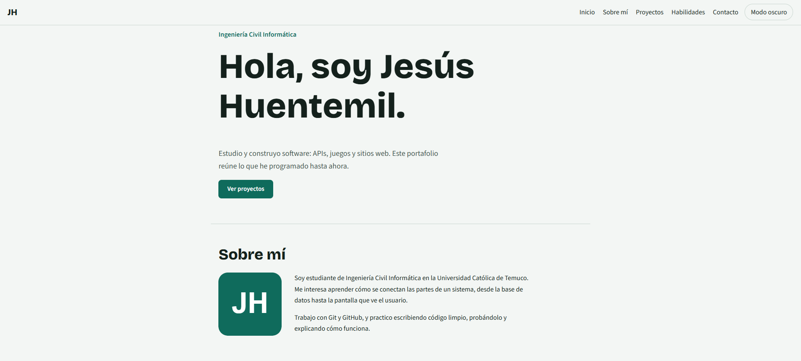
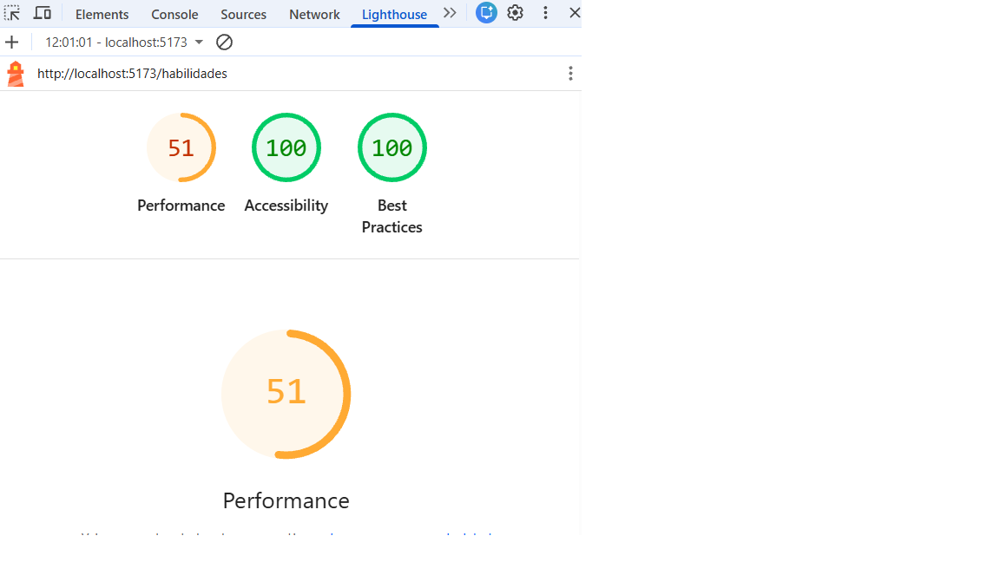

# Portafolio en React – Jesús Huentemil

Portafolio personal migrado desde la Evaluación 2 (HTML, CSS y JavaScript) a una SPA con React, TypeScript y Vite. Proyecto de la Evaluación 4 de Desarrollo de Frontend (ICINF1107), Universidad Católica de Temuco.

## Referencia visual (Evaluación 2)

Captura del portafolio original, para comparar el diseño:



El diseño conserva la estructura, la paleta, la tipografía y la jerarquía visual de la E2: barra de navegación, inicio, sobre mí, proyectos con filtros, habilidades, contacto y modo oscuro.

## Cómo ejecutarlo
```bash
# 1. Instalar dependencias
npm install

# 2. Servidor de desarrollo
npm run dev
# 3. Verificar tipos y generar la versión de producción (carpeta dist/)
npm run build

# 4. Previsualizar la compilación de producción
npm run preview
```
## Rutas

| Ruta | Página |
|---|---|
| `/` | Inicio |
| `/sobre-mi` | Sobre mí |
| `/proyectos` | Proyectos (filtros y repositorios de GitHub) |
| `/habilidades` | Habilidades |
| `/contacto` | Contacto (formulario validado) |
| `*` | Página 404 |

## API utilizada: GitHub REST API

- **Endpoint:** `https://api.github.com/users/jhuentemil2026-ui/repos?sort=updated&per_page=6`
- **Método:** GET, sin API key.
- **Parámetros:** `sort=updated` ordena por última actualización y `per_page=6` limita la cantidad de resultados.
- **Respuesta esperada (arreglo de objetos):**
```json
[
  {
    "id": 123,
    "name": "nombre-del-repo",
    "description": "texto o null",
    "html_url": "https://github.com/...",
    "language": "TypeScript o null",
    "stargazers_count": 0,
    "updated_at": "2026-11-18T12:00:00Z"
  }
]
```

La respuesta está tipada con la interfaz `GitHubRepo` en `src/types/index.ts`.

**Por qué elegí este endpoint:** muestra mis repositorios reales dentro del portafolio, así que la información se mantiene actualizada sin editar el código y se relaciona directamente con el propósito del sitio.

**Estados de la petición:** el hook `useFetchApi` maneja `loading`, `data` y `error`, y cancela la petición con `AbortController` al desmontar el componente para evitar condiciones de carrera.

## Arquitectura
```
src/
├── components/   Navbar, ProjectCard, StatusMessage, ContactForm
├── context/      themeContext y ThemeProvider (modo claro/oscuro)
├── data/         portfolioData.ts (datos estáticos tipados)
├── hooks/        useFetchApi, useTheme
├── pages/        Home, About, Projects, Skills, Contact, NotFound
├── services/     apiService.ts (URL de la API)
└── types/        interfaces y tipos TypeScript
```
- **Estilos:** un archivo CSS por componente, con nomenclatura BEM.
- **Estado:** `useState` para estado local (menú, filtro, formulario) y Context API para el tema, que es transversal.


## Accesibilidad

HTML semántico (`header`, `nav`, `main`, `section`, `article`), `label` asociado a cada campo con `htmlFor`, atributos ARIA (`aria-expanded`, `aria-pressed`, `aria-live`, `aria-invalid`), foco visible con `:focus-visible` y menú adaptable a móvil.

**Auditoría:**
- **Lighthouse (Mobile - `/habilidades`):** 100 en *Accessibility* y 100 en *Best Practices*.
- **Navegación por teclado:** Verificada con `Tab` y `Shift + Tab` en todas las rutas, enlaces de navegación, botones de filtro, cambio de tema y campos del formulario con foco visible (`:focus-visible`).



## Flujo de trabajo en Git

Ramas por funcionalidad (`feat/estructura-base`, `feat/tema-context`, `feat/rutas`, `feat/consumo-api`, `feat/contacto`, `docs/documentacion`), commits con Conventional Commits y Pull Requests fusionados hacia `main`.
## Documentación adicional
- [`INVENTARIO.md`](INVENTARIO.md): trazabilidad de la migración desde la E2.
- [`uso_ia.md`](uso_ia.md): bitácora de uso de IA.